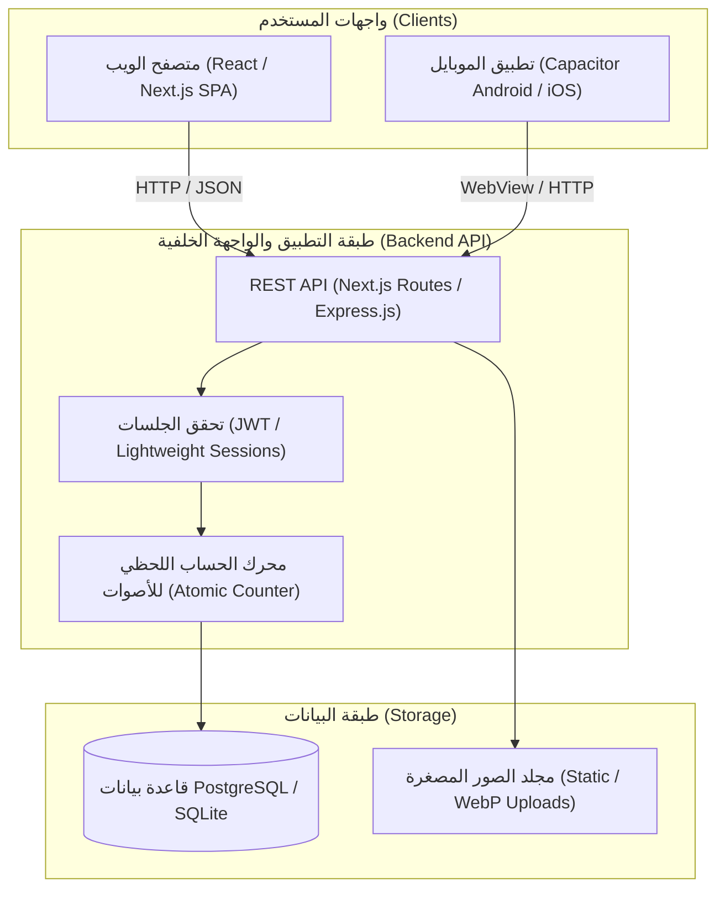

# معمارية النظام (System Architecture) - منصة وقاية (Weqaya G6PD)
**الإصدار:** 1.0 (معمارية مبسطة فائقة السرعة)  
**تاريخ التحديث:** أكتوبر 2026  

---

## 1. الرؤية الهندسية ومبادئ التصميم (Architectural Principles)
تم تصميم معمارية منصة **وقاية** وفق مبادئ السرعة الفائقة والاعتمادية مع الحد الأدنى من التكاليف والتعقيد:
1. **Single-Page Centric UX:** واجهة أمامية تفاعلية تعتمد على تحديثات الحالة اللحظية دون إعادة تحميل الصفحة (Optimistic UI updates).
2. **Lean Tech Stack:** تقليل الطبقات الوسيطة والاعتماد على بنية مباشرة بين الواجهة وقاعدة البيانات.
3. **Cross-Platform Readiness:** بناء الواجهة بتقنيات الويب المتجاوبة بالكامل لتمكين تحزيمها الفوري لتطبيق هاتف عبر **Capacitor** داخل مجلد `Mobile APP/`.

---

## 2. المخطط العام للنظام (System Architecture Diagram)



---

## 3. المكونات التقنية الرئيسية (Technology Stack)

| الطبقة (Layer) | التقنية المختارة | التبرير الهندسي (Rationale) |
|---|---|---|
| **الواجهة الأمامية (`Website/`)** | **React / Next.js** (App Router أو Vite SPA) | تحميل أولي فائق السرعة، تفاعلية عالية للبحث الفوري والشريط المزدوج، دعم RTL ممتاز. |
| **تطبيق الهاتف (`Mobile APP/`)** | **Capacitor / Ionic Capacitor** | تغليف الواجهة المتجاوبة نفسها في تطبيق Android/iOS بدون كتابة كود مكرر، مما يوفر سرعة إطلاق قياسية. |
| **الواجهة الخلفية (Backend API)** | **Next.js API Routes** أو **Node.js Express** | مسارات REST مباشرة وصغيرة، تعامل خفيف مع البيانات بصيغة JSON. |
| **قاعدة البيانات (Database)** | **PostgreSQL** أو **SQLite** | 3 جداول فقط، استعلامات بحث نصي سريعة، وعمليات كتابة ذرية لتحديث العدادات. |
| **التخزين (Assets Storage)** | **Local Static Storage / WebP** | صور خفيفة مضغوطة للمنتجات تُخزن وتُقدم مباشرة عبر مسار ثابت. |

---

## 4. هيكلية المجلدات في المشروع (Project Structure)

```text
Weqaya G6PD/
├── Docs/                           # كافة وثائق المشروع ومواصفاته الفنية
│   ├── 01_Product_Requirements_Document.md
│   ├── 02_System_Architecture.md
│   ├── 03_Database_Schema.md
│   ├── 04_API_Specification.md
│   ├── 05_UI_UX_Functional_Requirements.md
│   ├── 06_Google_Stitch_Design_Prompts.md
│   ├── 07_Workflows_and_RBAC.md
│   └── overview.txt
│
├── Website/                        # تطبيق الويب الموحد (Frontend + API)
│   ├── public/                     # الملفات العامة والشعارات والصور الثابتة
│   ├── src/
│   │   ├── components/             # مكونات واجهة المستخدم المستقلة
│   │   │   ├── Header.jsx          # الهيدر وزر الإضافة وتسجيل الدخول
│   │   │   ├── SearchBar.jsx       # شريط البحث وتصفية الفئات
│   │   │   ├── ItemCard.jsx        # بطاقة المنتج وشريط الأمان والتكسير
│   │   │   ├── VoteButtons.jsx     # زرا التصويت السريع
│   │   │   ├── AddItemModal.jsx    # نافذة إضافة منتج جديد
│   │   │   └── AuthModal.jsx       # نافذة تسجيل الدخول السريع (10 ثوانٍ)
│   │   ├── pages/ أو app/          # مسارات الصفحات ومسارات الـ API
│   │   │   └── api/                # نقاط النهاية (Auth, Items, Votes)
│   │   ├── lib/                    # أدوات الاتصال بقاعدة البيانات وتوليد التوكن
│   │   │   └── db.js
│   │   └── styles/                 # تنسيقات CSS نقية ومتجاوبة لدعم RTL
│   ├── package.json
│   └── capacitor.config.json       # إعدادات كاباسيتور لتحويل الويب لتطبيق
│
├── Mobile APP/                     # مشروع الموبايل المنبثق من الويب عبر كاباسيتور
│   ├── android/                    # كود أندرويد الجاهز للتجميع لـ APK
│   └── ios/                        # كود iOS
│
└── Google Stitch Design/           # مخرجات تصاميم Stitch والأصول المرئية
```

---

## 5. تدفق البيانات والأداء العالي (Data Flow & Performance)

### 5.1 البحث الفوري (Client-Side Search / Debounced API)
- عند كتابة 2 حرف أو أكثر في شريط البحث، يتم إرسال استعلام مخفف (Debounced 150ms) إلى الخادم أو التصفية محلياً من قائمة العناصر المحفوظة في الذاكرة (Memory Cache).
- يدعم التطبيق فهرسة نصية سريعة لأسماء الأغذية والأدوية.

### 5.2 التصويت المتفائل وتحديث العدادات (Optimistic Voting Flow)
1. يضغط المستخدم على `حصل تكسير ⚠️` أو `آمن معي ✅`.
2. يتم تحديث شريط التقدم والنسبة محلياً على الشاشة فوراً دون انتظار استجابة الخادم (Optimistic UI).
3. تُرسل طلبات التصويت عبر `POST /api/items/:id/vote`.
4. يقوم الخادم بتسجيل الصوت في جدول `votes` مع التأكد من منع التكرار (`UNIQUE(user_id, item_id)`).
5. يقوم الخادم بتحديث الأعمدة التراكمية في جدول `items` (`hemolysis_votes`, `safe_votes`, `total_votes`) في عملية ذرية واحدة (Atomic Update).

---

## 6. استراتيجية الموبايل (Capacitor Strategy)
- واجهة `Website/` مصممة بنهج **Mobile-First Responsive Design** وتدعم أبعاد الشاشات كافة.
- يتم ربط كود `Website/` داخل `Mobile APP/` بواسطة Capacitor:
  ```bash
  # مزامنة مخرجات الويب مع مجلد تطبيق الهاتف
  npx cap copy
  npx cap open android
  ```
- النتيجة: تطبيق هاتف Android APK سريع جداً مع تجربة Native كاملة وأداء سلس.
