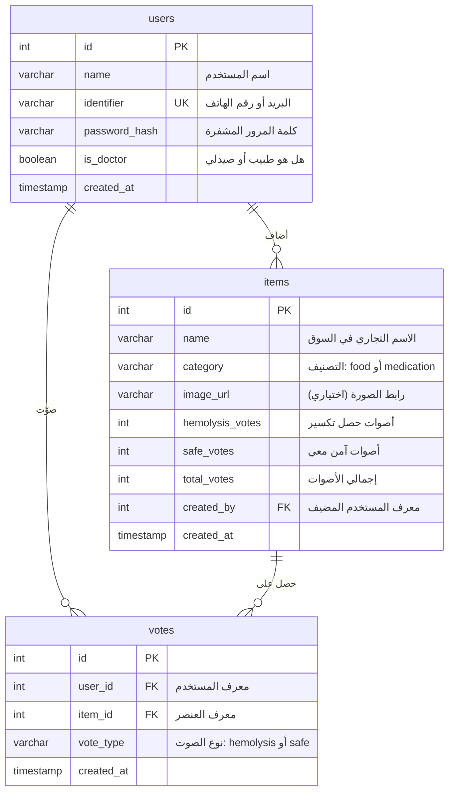

# مخطط قاعدة البيانات (Database Schema) - منصة وقاية (Weqaya G6PD)
**الإصدار:** 1.0 (مخطط النواة فائق البساطة - 3 جداول فقط)  
**تاريخ التحديث:** أكتوبر 2026  

---

## 1. نظرة عامة وفلسفة التصميم
تعتمد منصة **وقاية** على هيكل بيانات فائق البساطة يتألف من **3 جداول فقط** لضمان سرعة الاستعلامات، وانعدام التعقيد، وسهولة النقل والصيانة عبر أي محرك قواعد بيانات (PostgreSQL أو SQLite):
1. **`users`**: لتخزين بيانات المستخدمين والأطباء.
2. **`items`**: لتخزين الأصناف الغذائية والدوائية بالأسماء الشائعة في السوق مع عدادات الأصوات المجمعة.
3. **`votes`**: لتسجيل أصوات المستخدمين ومنع تكرار التصويت (`UNIQUE(user_id, item_id)`).

---

## 2. مخطط العلاقات الكيانية (ER Diagram)



---

## 3. تعريف الجداول وتفاصيل الحقول (Table Definitions)

### 3.1 جدول المستخدمين (`users`)
| الحقل (Column) | النوع (Type) | القيود (Constraints) | الوصف |
|---|---|---|---|
| `id` | SERIAL / INTEGER | PRIMARY KEY | المعرف الفريد للمستخدم |
| `name` | VARCHAR(100) | NOT NULL | الاسم المعروض |
| `identifier` | VARCHAR(120) | NOT NULL, UNIQUE | البريد الإلكتروني أو رقم الهاتف |
| `password_hash` | VARCHAR(255) | NOT NULL | هاش كلمة المرور (Bcrypt / Argon2) |
| `is_doctor` | BOOLEAN | DEFAULT FALSE | شارة طبيب / صيدلي للمساهمات المهنية |
| `created_at` | TIMESTAMP | DEFAULT CURRENT_TIMESTAMP | تاريخ التسجيل |

### 3.2 جدول الأصناف (`items`)
| الحقل (Column) | النوع (Type) | القيود (Constraints) | الوصف |
|---|---|---|---|
| `id` | SERIAL / INTEGER | PRIMARY KEY | المعرف الفريد للصنف |
| `name` | VARCHAR(200) | NOT NULL | الاسم الشائع في السوق المصري |
| `category` | VARCHAR(20) | NOT NULL CHECK (category IN ('food', 'medication')) | التصنيف: أكل أو دواء |
| `image_url` | VARCHAR(255) | NULL | مسار الصورة (اختياري) |
| `hemolysis_votes`| INTEGER | DEFAULT 0 | عدد الأصوات المسجلة لـ "حصل تكسير" |
| `safe_votes` | INTEGER | DEFAULT 0 | عدد الأصوات المسجلة لـ "آمن معي" |
| `total_votes` | INTEGER | DEFAULT 0 | إجمالي الأصوات (مجموع الاثنين) |
| `created_by` | INTEGER | REFERENCES users(id) ON DELETE SET NULL | المستخدم الذي أضاف الصنف |
| `created_at` | TIMESTAMP | DEFAULT CURRENT_TIMESTAMP | تاريخ الإضافة |

### 3.3 جدول الأصوات (`votes`)
| الحقل (Column) | النوع (Type) | القيود (Constraints) | الوصف |
|---|---|---|---|
| `id` | SERIAL / INTEGER | PRIMARY KEY | المعرف الفريد للتصويت |
| `user_id` | INTEGER | NOT NULL, REFERENCES users(id) ON DELETE CASCADE | المستخدم صاحب التصويت |
| `item_id` | INTEGER | NOT NULL, REFERENCES items(id) ON DELETE CASCADE | الصنف المصوّت عليه |
| `vote_type` | VARCHAR(15) | NOT NULL CHECK (vote_type IN ('hemolysis', 'safe')) | نوع التصويت |
| `created_at` | TIMESTAMP | DEFAULT CURRENT_TIMESTAMP | تاريخ ووقت التصويت |
| **قيد التميز** | **UNIQUE** | **UNIQUE (user_id, item_id)** | **يمنع تصويت المستخدم لنفس الصنف مرتين** |

---

## 4. نصوص إنشاء قاعدة البيانات (SQL DDL)

### 4.1 صيغة PostgreSQL
```sql
-- 1. إنشاء جدول المستخدمين
CREATE TABLE IF NOT EXISTS users (
    id SERIAL PRIMARY KEY,
    name VARCHAR(100) NOT NULL,
    identifier VARCHAR(120) NOT NULL UNIQUE,
    password_hash VARCHAR(255) NOT NULL,
    is_doctor BOOLEAN DEFAULT FALSE,
    created_at TIMESTAMP WITH TIME ZONE DEFAULT CURRENT_TIMESTAMP
);

-- 2. إنشاء جدول الأصناف
CREATE TABLE IF NOT EXISTS items (
    id SERIAL PRIMARY KEY,
    name VARCHAR(200) NOT NULL,
    category VARCHAR(20) NOT NULL CHECK (category IN ('food', 'medication')),
    image_url VARCHAR(255),
    hemolysis_votes INTEGER NOT NULL DEFAULT 0,
    safe_votes INTEGER NOT NULL DEFAULT 0,
    total_votes INTEGER NOT NULL DEFAULT 0,
    created_by INTEGER REFERENCES users(id) ON DELETE SET NULL,
    created_at TIMESTAMP WITH TIME ZONE DEFAULT CURRENT_TIMESTAMP
);

-- 3. إنشاء جدول التصويتات
CREATE TABLE IF NOT EXISTS votes (
    id SERIAL PRIMARY KEY,
    user_id INTEGER NOT NULL REFERENCES users(id) ON DELETE CASCADE,
    item_id INTEGER NOT NULL REFERENCES items(id) ON DELETE CASCADE,
    vote_type VARCHAR(15) NOT NULL CHECK (vote_type IN ('hemolysis', 'safe')),
    created_at TIMESTAMP WITH TIME ZONE DEFAULT CURRENT_TIMESTAMP,
    CONSTRAINT unique_user_item_vote UNIQUE (user_id, item_id)
);

-- فهارس لتحسين سرعة البحث
CREATE INDEX IF NOT EXISTS idx_items_name ON items (name);
CREATE INDEX IF NOT EXISTS idx_items_category ON items (category);
CREATE INDEX IF NOT EXISTS idx_votes_item ON votes (item_id);
```

### 4.2 صيغة SQLite (للتشغيل المباشر الخفيف)
```sql
CREATE TABLE IF NOT EXISTS users (
    id INTEGER PRIMARY KEY AUTOINCREMENT,
    name TEXT NOT NULL,
    identifier TEXT NOT NULL UNIQUE,
    password_hash TEXT NOT NULL,
    is_doctor INTEGER DEFAULT 0,
    created_at DATETIME DEFAULT CURRENT_TIMESTAMP
);

CREATE TABLE IF NOT EXISTS items (
    id INTEGER PRIMARY KEY AUTOINCREMENT,
    name TEXT NOT NULL,
    category TEXT NOT NULL CHECK(category IN ('food', 'medication')),
    image_url TEXT,
    hemolysis_votes INTEGER NOT NULL DEFAULT 0,
    safe_votes INTEGER NOT NULL DEFAULT 0,
    total_votes INTEGER NOT NULL DEFAULT 0,
    created_by INTEGER REFERENCES users(id) ON DELETE SET NULL,
    created_at DATETIME DEFAULT CURRENT_TIMESTAMP
);

CREATE TABLE IF NOT EXISTS votes (
    id INTEGER PRIMARY KEY AUTOINCREMENT,
    user_id INTEGER NOT NULL REFERENCES users(id) ON DELETE CASCADE,
    item_id INTEGER NOT NULL REFERENCES items(id) ON DELETE CASCADE,
    vote_type TEXT NOT NULL CHECK(vote_type IN ('hemolysis', 'safe')),
    created_at DATETIME DEFAULT CURRENT_TIMESTAMP,
    UNIQUE(user_id, item_id)
);

CREATE INDEX IF NOT EXISTS idx_items_name ON items (name);
CREATE INDEX IF NOT EXISTS idx_items_category ON items (category);
CREATE INDEX IF NOT EXISTS idx_votes_item ON votes (item_id);
```

---

## 5. البيانات التجريبية الأولية (Seed Data)
أمثلة حقيقية لأشهر الأطعمة والأدوية المتداولة في السوق المصري لاختبار المنصة فوراً:

```sql
-- مستخدم تجريبي أولي
INSERT INTO users (id, name, identifier, password_hash, is_doctor)
VALUES 
(1, 'د. أحمد ممدوح', 'doctor@weqaya.org', '$2a$10$w8TKnN9kYw0p47pPz...', 1),
(2, 'أم يوسف', 'om.youssef@example.com', '$2a$10$w8TKnN9kYw0p47pPz...', 0);

-- أغذية وأدوية شائعة بالسوق المصري
INSERT INTO items (name, category, hemolysis_votes, safe_votes, total_votes, created_by)
VALUES
-- أطعمة مصرية
('طعمية سخنة (فول مقلي)', 'food', 142, 6, 148, 1),
('لانشون حلواني سادة (بدون بروتين فول صويا)', 'food', 8, 89, 97, 2),
('بسكويت كتاكيتو شوكولاتة', 'food', 4, 112, 116, 2),
('فول مدمس بالزيت الحار', 'food', 210, 3, 213, 1),
('حمص الشام الجاهز (حلبسة)', 'food', 64, 12, 76, 1),
('شيبسي كباب وكراتيه بطعم الفلافل', 'food', 45, 18, 63, 2),
('كبدة إسكندراني بالثوم والليمون', 'food', 2, 74, 76, 2),

-- أدوية شائعة بالسوق المصري
('أقراص ريفو الخضراء (أسبيرين 320 مجم)', 'medication', 165, 8, 173, 1),
('سيبتازول / سبترين (كوتريموكسازول)', 'medication', 188, 2, 190, 1),
('بنادول أزرق سادة (باراسيتامول 500)', 'medication', 5, 230, 235, 1),
('سبازموبيرالجين (مسكن ومضاد للتقلصات)', 'medication', 94, 9, 103, 1),
('بروفين 400 (إيبوبروفين)', 'medication', 14, 120, 134, 1),
('أوجمنتين مضاد حيوي 1 جم', 'medication', 7, 145, 152, 1);
```
