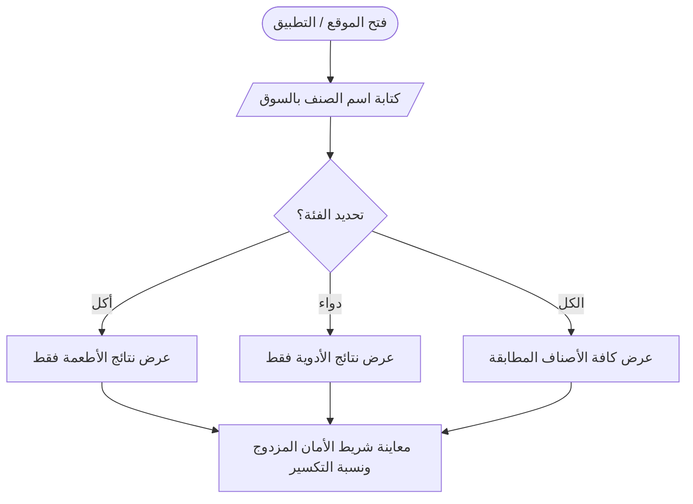
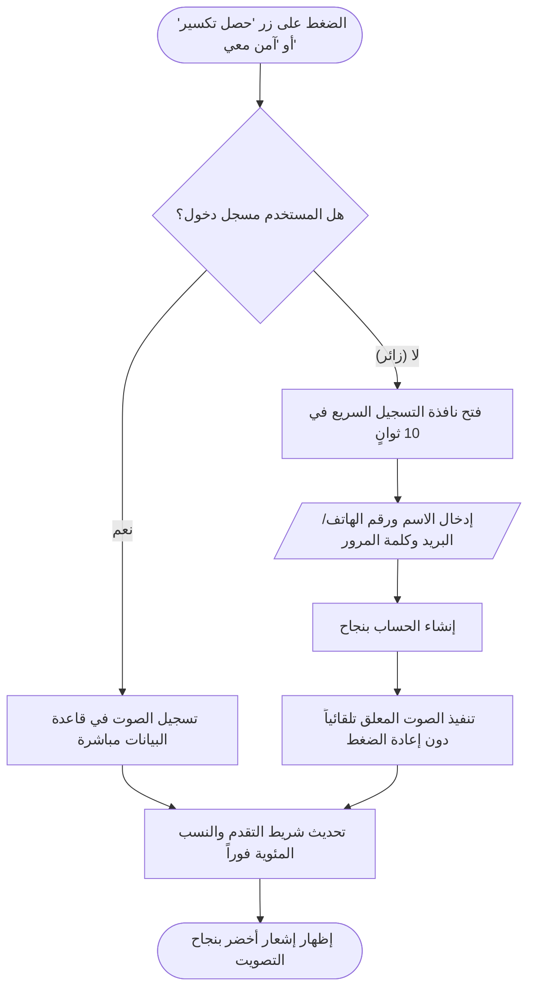
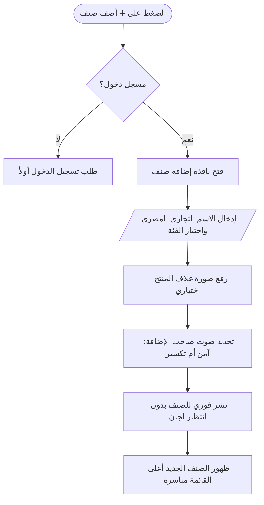

# مسارات العمل وصلاحيات المستخدمين (Workflows & RBAC) - منصة وقاية
**الإصدار:** 1.0 (نظام صلاحيات مبسط وعملي)  
**تاريخ التحديث:** أكتوبر 2026  

---

## 1. مصفوفة الصلاحيات المبسطة (Role-Based Access Control)
لتجنب التعقيد الإداري، تم حصر الصلاحيات في **3 أدوار رئيسية بسيطة وواضحة**:

| الصلاحية / الوظيفة | الزائر (Guest) | المستخدم المسجل (User) | الطبيب / الصيدلي (Doctor) |
|---|:---:|:---:|:---:|
| **تصفح الدليل والبحث الفوري** | ✅ متاح بالكامل | ✅ متاح بالكامل | ✅ متاح بالكامل |
| **مشاهدة نسب الأمان وأشرطة التكسير** | ✅ متاح بالكامل | ✅ متاح بالكامل | ✅ متاح بالكامل |
| **التصويت على الأصناف** | 🟡 يفتح نافذة تسجيل سريعة | ✅ صوت واحد لكل صنف | ✅ صوت واحد لكل صنف |
| **تعديل التصويت الشخصي** | ❌ غير متاح | ✅ متاح في أي وقت | ✅ متاح في أي وقت |
| **إضافة صنف جديد بالاسم التجاري** | ❌ يتطلب تسجيل | ✅ نشر فوري ومباشر | ✅ نشر فوري ومباشر |
| **شارة التوثيق الطبي المهني (`🩺`)** | ❌ | ❌ | ✅ تظهر بجانب الاسم والمساهمات |

---

## 2. مسارات العمل التفاعلية (User Workflows)

### 2.1 مسار البحث والاستكشاف (Search & Discovery Workflow)

---

### 2.2 مسار التصويت واعتراض الزائر (Voting & Auth Intercept Workflow)
المسار الأكثر أهمية، حيث يتم تحويل الزائر إلى مستخدم مسجل دون فقدان سياق التصويت:

---

### 2.3 مسار إضافة صنف جديد والنشر الفوري (Add Item Workflow)

---

## 3. قواعد النزاهة ومنع التلاعب (Anti-Abuse & Rate Limiting)
نظراً لطبيعة المنصة القائمة على المشاركة المجتمعية الحرة، يتم تطبيق آليات خفيفة وفعالة لمنع الإغراق (Spam):
1. **قيد الصوت الواحد الصارم (Database Level):**
   - تم قفل التصويت على مستوى قاعدة البيانات باستخدام `UNIQUE(user_id, item_id)`. لا يمكن لأي حساب تكرار التصويت لنفس الصنف بل يُسمح فقط بتعديل الاختيار السابق.
2. **الحد الأقصى للإضافات (Rate Limiting):**
   - يُسمح للحساب الواحد بإضافة بحد أقصى **5 أصناف جديدة في الساعة** لمنع برمجيات النشر الآلي (Bots).
3. **تتبع عنوان الـ IP السريع:**
   - منع إنشاء أكثر من 3 حسابات خلال 10 دقائق من نفس عنوان الـ IP لحماية نزاهة التصويت.
